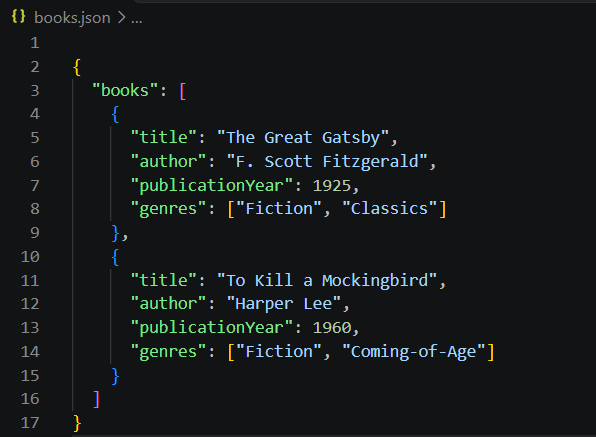
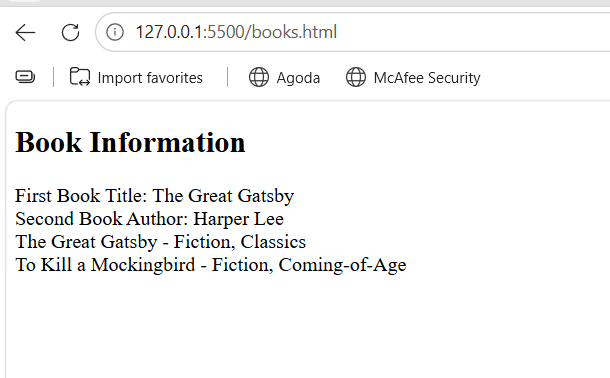
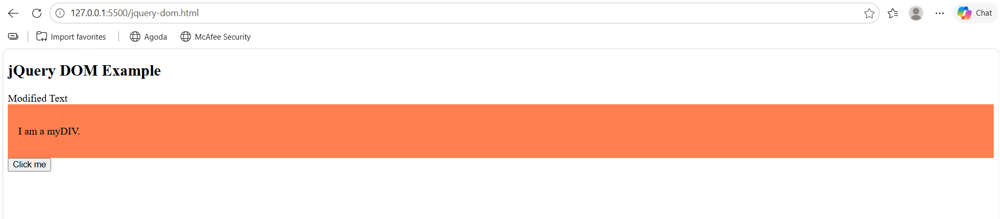
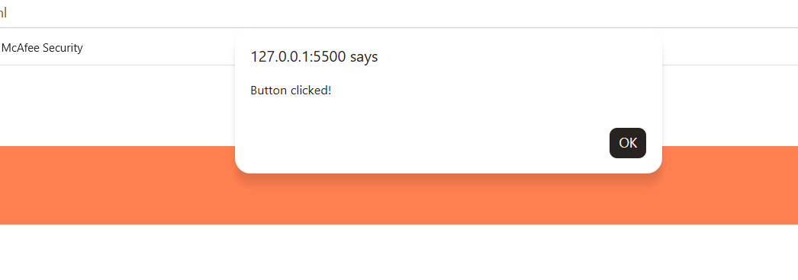

# Lab 4b: Client-Side Scripting (JSON and jQuery)

**Course:** BIC21203 Web Development  
**Name:** Nafisa Rasyiqah binti Razman  
**Matric Number:** AI240045  
**Academic Session:** 2026/2027

## Question 1: Create and Structure JSON Data

The `books.json` file stores information about two books, including their titles, authors, publication years and genres.

## Question 2: Retrieve and Display JSON Data

The `books.html` file uses the JavaScript fetch() API to retrieve data from books.json and display the required book information on the webpage.

## Question 3: Compare Native JavaScript and jQuery

The `jquery-dom.html` file uses jQuery to change text, add a CSS class and display an alert when a button is clicked.

## How to Run

1. Open the lab4b folder in Visual Studio Code.
2. Install Live Server if necessary.
3. Right-click books.html and select Open with Live Server.
4. Open jquery-dom.html with Live Server to test Question 3.

## Screenshots

### Question 1: JSON Data

### Question 2: Display Book Information

### Question 3: jQuery DOM Operations

**Button Alert:**

## Conclusion

This lab demonstrates how to structure JSON data, retrieve data using fetch(), and manipulate webpage elements using jQuery.
